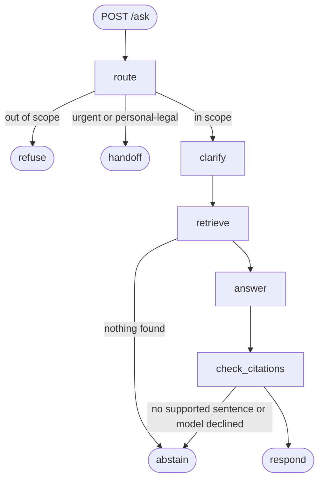

# Architecture

PermiPath answers questions about French residence permits for international students from
official sources only, with article-level citations. This document describes the request path
of the agent (build step 4). Decisions and their reasons are in `decisions.md`; measured
results are in `eval-results.md`.

## Components

| Component | Module | Role |
|---|---|---|
| API | `backend/app/ask.py` | `POST /ask`: validates the request, runs the graph, writes a metadata-only log row. |
| Agent graph | `backend/rag/graph.py` | LangGraph `StateGraph`; wires the nodes below. |
| Scope routing | `backend/guardrails/scope.py` | In scope, out of scope (refuse) or handoff; flags personal questions. |
| Nationality | `backend/guardrails/nationality.py` | Algerian only on an explicit mention. |
| Retrieval | `backend/rag/retrieval.py`, `rag/fusion.py` | Full-text and vector rankings fused with RRF, metadata filters (D-016). |
| Precedence | `backend/rag/precedence.py`, `rag/search.py` | Which source governs; order of sources (D-017). |
| Answer | `backend/rag/answer.py`, `rag/prompts/` | Structured answer from `mistral-small-2603`; versioned prompts. |
| Citation check | `backend/rag/citations.py` | Removes sentences without valid citations or with figures absent from the cited chunks. |
| Abstain gate | `backend/rag/abstain.py` | No retrieval, model declined, or no supported sentence. |
| Fixed texts | `backend/guardrails/texts.yaml` | Notices and refuse / handoff / abstain responses (FR, EN; draft wording). |

## Request flow

| Node | Input | Output |
|---|---|---|
| `route` | question | scope decision; answer language (requested, else detected) |
| `clarify` | question, requested nationality | nationality: `algerian`, `other` or `unknown` |
| `retrieve` | question, nationality, date | up to 10 chunks after precedence; governing source |
| `answer` | question, chunks, precedence decision | sentences, each citing source labels |
| `check_citations` | sentences, chunks | kept and removed sentences; abstain reason |
| `respond` | kept sentences | numbered sources with links, in-force date, date checked; notices |
| `refuse`, `handoff`, `abstain` | scope reason or abstain reason | fixed text; for `abstain`, the best official page found |

Every response starts its notices with "not legal advice". An answer about an Algerian national
states that the agreement governs; an answer whose nationality is unknown says that Algerian
nationals fall under the agreement. The `eligibility` node (SQL rules table) is added in build
step 5.

## Retrieval and precedence

1. The question is embedded once with `mistral-embed`.
2. Two rankings over `chunks`, 50 candidates each: Postgres full-text (`french`, stemmed terms
   joined with OR) and pgvector cosine. Both apply the filters: nationality scope, in force on
   the question date, prefecture.
3. Reciprocal Rank Fusion, k = 60, lexical weight 0.5, vector weight 1.0.
4. Algerian residence-rights question: the best 3 chunks of the agreement and the case law are
   retrieved separately and merged; the agreement and case law are ranked first. Algerian
   procedure question: fact sheets first. Other questions: fused order.

## Answer and citation check

The model receives the question and the sources labelled `S1` to `S10`, and returns
`{declined, sentences: [{text, source_ids}]}` (`json_schema` structured output). Labels are
mapped back to chunk ids. A sentence is shown only if it cites retrieved chunks and every
figure it states appears in the title or text of a cited chunk (digits, or French number words
in the source). Removed sentences are counted in the log, never shown.

## Data and privacy

| Store | Content |
|---|---|
| `chunks` | Official sources: text, metadata, `tsv`, `embedding` (Postgres + pgvector). |
| `query_logs` | Per request: journey stage, retrieved chunk ids, latency, token counts, eval flags. No question text (CLAUDE.md, rule 5). |

The agent has no write action outside `query_logs`.
